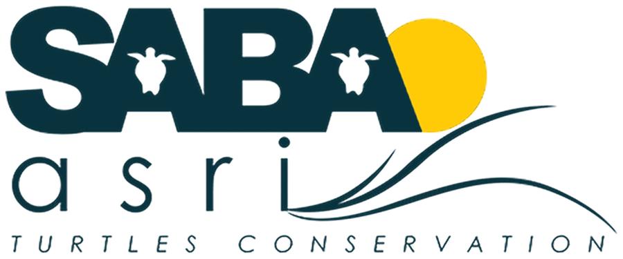

  <picture>
    <source media="(prefers-color-scheme: dark)" srcset="app/images/saba-asri-logo-light.png">
    
  </picture>

# Live Interpreter

**Speak in one language and see it translated into another — on your phone or computer.**

## 👉 [Open the translator](https://melvin-tai.github.io/Audio-Language-Interpretation/)

**melvin-tai.github.io/Audio-Language-Interpretation**

Nothing to install and no account needed. It's free and works in your web browser.

**Languages:** English · French · German · Mandarin Chinese · Japanese · Indonesian, in any direction.

---

## How to use it

1. **Open the link** above.
2. Choose the language you will speak (**I speak**) and the language you want to read (**Translate to**).
3. **Tap the blue microphone button.** The first time, your browser asks to use the microphone. Tap **Allow**.
4. **Speak normally.** Pause briefly after each sentence. Each sentence appears with its translation underneath, newest at the top.
5. **Tap the button again** to stop.

> 💡 **Talking with someone?** Tap ⇄ to swap the languages when it's their turn to speak.

---

## Which phone or computer?

| Device | Best browser |
|---|---|
| Android phone | **Chrome** |
| iPhone or iPad | **Safari** |
| Computer | **Google Chrome** (gives the best translations) |

Other browsers (Firefox, Edge, Samsung Internet…) work too. The first time, they may need to download speech recognition, which takes a minute.

**On a phone:** keep the page open and the screen on while you talk. If the phone locks, just tap the button again.

**Tip:** add it to your home screen so it opens like an app.
- **Android (Chrome):** tap **⋮**, then **Add to Home screen**.
- **iPhone (Safari):** tap **Share**, then **Add to Home Screen**.

---

## Tips for good translations

- Speak clearly, in **full sentences**, close to the phone.
- **One person at a time**, and as little background noise as possible.
- Pick the right **I speak** language before you start. The app doesn't guess it.
- Automatic translation is a helpful guide, not a professional interpreter. For medical, legal or other important matters, please use a qualified human interpreter.

---

## Privacy

- **Nothing is saved.** There are no accounts, no recordings and no history. Close the page and it's gone.
- To turn speech into text, your browser may send your voice to its own speech service, as it does for voice typing (for example, Google for Chrome and Apple for Safari).
- To translate, the text may be sent to a free translation service (MyMemory). On a computer, Google Chrome can translate on the computer itself instead.

---

## Something not working?

| Problem | What to do |
|---|---|
| **"Microphone access was blocked"** | Tap the 🔒 or ⓘ icon next to the web address, set **Microphone** to **Allow**, then reload the page. On iPhone, also check **Settings → Apps → Safari → Microphone**. |
| **Nothing appears when I speak** | Check that **I speak** is set to the language you're speaking, that your microphone isn't muted, and pause briefly after each sentence. On iPhone, make sure **Settings → General → Keyboard → Enable Dictation** is on. |
| **"One-time download"** message | This is normal the first time in some browsers. Wait for it to finish; next time it starts straight away. |
| **"Today's free translation limit has been reached"** | The free translation service has a daily limit. Try again tomorrow, or use Google Chrome on a computer. |
| **A translation looks odd** | Try saying the whole sentence again, a little more slowly. Very short phrases are the hardest to translate. |
| **Chinese shows Traditional characters** | This can happen outside Chrome and Safari. Use Chrome or Safari for Simplified Chinese. |

---

Made for SABA asri Turtles Conservation. For programmers: the code, tests and technical notes are in [`developer/`](developer/README.md). Speech recognition uses your browser's built-in service or OpenAI's Whisper model. Translation uses Chrome's built-in translator, the MyMemory service, or Meta's NLLB-200 model (non-commercial licence). Code licence: [MIT](LICENSE).
