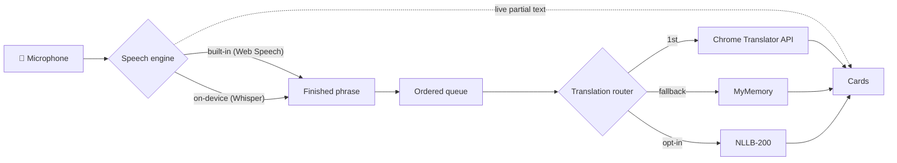

# Developer guide

The technical companion to the main [README](../README.md). Everything a programmer needs to run, test, change, publish and extend Live Interpreter.

**Live site:** https://melvin-tai.github.io/Audio-Language-Interpretation/

**Stack:** plain HTML + CSS + native ES modules. There is no framework, no bundler and no build step, so the files in `app/` are exactly what the browser runs. AI models load at runtime from a CDN through [transformers.js](https://github.com/huggingface/transformers.js), pinned to `4.3.1`.

---

## Run locally

```bash
cd developer
npm start                        # zero-dependency server → http://localhost:8080
# or, from the repo root, with Python:
python3 -m http.server 8080
```

A server is required because browsers block ES modules, workers and `getUserMedia` on `file://`. `localhost` counts as a secure context; a LAN IP over plain `http://` does **not**, so test phones against the deployed HTTPS site or a tunnel.

## Test

```bash
cd developer
npm test           # 44 unit tests, Node ≥ 22.12, no install needed
npm run check      # syntax-check every file in app/js
npm install        # once: puppeteer + Chrome for the browser tests
npm run test:e2e   # 3 headless-Chrome tests
```

**Unit tests (`tests/unit/`)** cover:
- Audio: resampler accuracy at 48 kHz and 44.1 kHz across chunk boundaries; segmenter splitting, pause tolerance, blip rejection, noise immunity, force-cut and flush.
- Built-in speech engine, against a fake `SpeechRecognition` that mimics phones: one phrase per session, sessions ending without a final result, language-code fallback, fatal errors and restart-loop detection.
- Translation: MyMemory byte-limit chunking (including CJK), entity decoding and error/quota handling; router fallback and per-pair memory.
- App logic: settings validation and per-device defaults; device detection; controller ordering, auto-fallback and plain-language errors.

**E2E tests (`tests/e2e/`)** run in real headless Chrome:
1. **Desktop.** A synthetic two-phrase "speech" WAV goes through Chrome's fake microphone. The test checks the whole path: AudioWorklet → resampler → segmenter → worker → translation → cards.
2. **Phone.** Uses an Android user agent at a 360 px viewport. It checks there is no sideways scrolling, the large button, that the page shows only the two language pickers (no technical settings), that the Quick model is used, and that recording works.
3. **`file://`.** Opening the file directly shows the friendly explanation with a link to the live site.

The Whisper/NLLB worker and the MyMemory HTTP API are stubbed, so the tests are fast, offline and deterministic. Real model inference, Chrome's Translator API and Web Speech need manual testing.

**Manual checklist** (≈10 min):
- **Desktop Chrome:** EN→JA with no URL parameters, then again with `?asr=whisper` (on-device recognition).
- **Firefox:** confirm it falls back to on-device recognition plus MyMemory.
- **Android Chrome and iPhone Safari:** say a few sentences, lock the screen mid-way, and confirm you can resume.
- **Permissions:** deny the microphone and check the error text.

CI (`.github/workflows/tests.yml`) runs the unit and e2e tests on every push and PR. Deployment is GitHub Pages "Deploy from a branch" (root), so publishing needs no workflow.

---

## Publishing & updating the site

The site is served by **GitHub Pages → Deploy from a branch → `main` / `(root)`**. `index.html` must stay at the top level of the repository. Any change pushed to `main` goes live within a few minutes.

**Without a terminal**, on github.com:
1. Open the repository and click **Add file → Upload files**.
2. Drag in the changed files or folders. Keep the same folder structure; a file with the same path replaces the old one.
3. Click **Commit changes**.
4. To delete a file, open it on GitHub, click **⋯ → Delete file**, then **Commit changes**.

**Version tag (cache-busting).** GitHub Pages lets browsers reuse files for up to 10 minutes. Without care, a visitor can get the new `index.html` with the *old* `styles.css` and see a broken page. So `index.html` loads `app/styles.css?v=…` and `app/js/main.js?v=…`. **Change that date in both places whenever you change the CSS or JavaScript** — browsers then fetch the new files immediately. (Modules imported by `main.js` aren't tagged; they refresh within 10 minutes.)

Check **Settings → Pages** if the site doesn't update: the source must be *Deploy from a branch*, branch `main`, folder `/ (root)`.

To host your **own copy**, fork the repository (or upload these files to a new public repository) and enable Pages the same way. Your link becomes `https://YOUR-USERNAME.github.io/REPO-NAME/`. Update the live-site URL in `index.html` (file notice, canonical/og tags, footer) and `app/js/main.js` (secure-context message) to match.

---

## Architecture



- **`main.js`** builds the page: two language pickers, the button and the result cards. Engine choices come from `DEFAULT_SETTINGS` (phone-aware) plus optional URL overrides; nothing technical is shown to the user.
- **`interpreter.js`** is the controller. It owns start/stop, the auto-fallback from Web Speech to Whisper, and the ordered translation queue. It talks to a small *view* interface (`setStatus`, `setLive`, `setRecording`, `addPhrase`, `setTranslation`) instead of the DOM, which is why it's unit-tested without a browser.
- **Web Speech engine.** Desktop uses `continuous = true`. Phones use one phrase per session with auto-restart, because continuous mode accumulates or duplicates results on Android and iOS. Leftover interim text is promoted to final on `end`, since iOS often ends without a final result.
- **Whisper engine.** The pipeline is mic → AudioWorklet → linear resampler (Firefox can't attach a mic to a 16 kHz `AudioContext`) → energy VAD segmenter → Web Worker. The VAD settings are a 30 ms frame, an adaptive noise floor with a 3× ratio, a 700 ms pause to end a phrase, and a 15 s force-cut. A filter drops Whisper's known hallucinations such as subtitle credits.
- **Translation router.** Engines are tried in order. Permanent failures (unsupported pair, quota) are remembered per engine and language pair. Chrome's `Translator.create()` is called synchronously inside the click handler, because downloading a model requires user activation.
- **Phones.** Phones default to the Quick (tiny) model, keep the screen awake with the Screen Wake Lock API, and create the `AudioContext` before the first `await` so iOS treats it as user-initiated.

### File map

```
index.html                     page markup (+ inline file:// notice)
app/styles.css                 SABA asri theme (deep-sea header, white body), phone-first, CJK-aware fonts via :lang()
app/fonts/                     Jost variable font, self-hosted (SIL OFL 1.1 — see OFL.txt)
app/images/                    logo (light = on dark, dark = on white), share.png (link previews), touch-icon.png
app/js/
  main.js                      DOM wiring + view implementation (no logic)
  config.js                    ★ languages, models, endpoints, VAD tuning
  settings.js                  URL > localStorage (languages only) > defaults, validated
  device.js                    phone detection, screen wake lock
  interpreter.js               controller
  audio/        microphone.js · capture-processor.js (AudioWorklet) · resample.js · segmenter.js
  recognition/  index.js (picker) · webspeech.js · whisper.js
  translation/  index.js (router) · chrome-builtin.js · mymemory.js · nllb.js
  workers/      ml.worker.js (transformers.js pipelines) · ml-client.js (RPC)
developer/
  serve.mjs · check-syntax.mjs · package.json · tests/{unit,e2e}
```

---

## Brand & design

| Token | Value | Used for |
|---|---|---|
| Abyss | `#08323d` | Header band, "listening" button, focus ring, browser bar (`theme-color`) |
| Lagoon | `#0b6f7a` | Microphone button, links, text buttons |
| Sun | `#ffcb06` | From the logo; only the "listening" ring and stop icon |
| Sea glass | `#eef5f4` | Phrase cards |
| Ink / Tide | `#10272d` / `#52696e` | Body / secondary text (all text ≥ 4.5:1 contrast) |

Typeface: **Jost** (geometric, close to the logo's "asri" lettering), self-hosted so no request goes to Google. The logo files were cut out of the original black-background artwork; the *light* version keeps the original white + yellow for the header, the *dark* version recolours the white to Abyss for white backgrounds (README, file:// notice).

## Extending

**Add a language.** Add one entry to `LANGUAGES` in `config.js` with each engine's code:

```js
{ id: 'es', name: 'Spanish', native: 'Español', speech: ['es-ES'], whisper: 'es',
  translator: 'es', mymemory: 'es', nllb: 'spa_Latn' },
```

**Add an engine.**
- Translation: export `{ id, label, isSupported(), translate(text, src, tgt), prepare?() }` and register it in `translation/index.js`.
- Speech: write a class with `id`, `label`, `start(callbacks)` and `stop()`, and register it in `recognition/index.js`.

**Tune phrase detection.** Edit `SEGMENTER` in `config.js`:
- `maxSilenceMs`: pause length that ends a phrase.
- `noiseRatio`: how far speech must be above the noise floor.
- `minThreshold`: absolute floor for speech.
- `maxSegmentMs`: force-cut length.

**MyMemory quota.** Set `MYMEMORY.email` in `config.js`. This raises the limit from about 5,000 to about 50,000 characters per day. The address is sent with each request and is visible in the public source.

**Settings and URL parameters.** The page deliberately has no settings panel: engines are chosen automatically and only the two languages are remembered (localStorage). For testing or power users, the query string overrides choices **for that visit only**:
- `from`, `to`: `en`, `fr`, `de`, `zh`, `ja`, `id` (e.g. `?from=ja&to=en` — handy for sharing a pre-set link)
- `asr`: `auto`, `webspeech`, `whisper`
- `model`: `tiny`, `base`, `small`
- `mt`: `auto`, `chrome`, `mymemory`, `nllb`

Invalid values are ignored. Example — fully private on a desktop: `?asr=whisper&mt=nllb`.

## Facts this code relies on (verified Oct 2026)

| Topic | Value |
|---|---|
| Web Speech codes | `en-US`, `fr-FR`, `de-DE`, `cmn-Hans-CN` (fallback `zh-CN`), `ja-JP`, `id-ID` |
| Web Speech support | Chrome (desktop and Android) and Safari 14.1+ have it. Edge and Opera expose it, but it is unreliable there; Firefox doesn't have it |
| Chrome Translator API | Desktop Chrome 138+, not mobile, and requires user activation to download a model |
| Whisper language codes | `en`, `fr`, `de`, `zh`, `ja`, `id` |
| Whisper q8 download sizes | tiny ≈ 41 MB, base ≈ 77 MB, small ≈ 249 MB |
| NLLB codes and size | `eng_Latn`, `fra_Latn`, `deu_Latn`, `zho_Hans`, `jpn_Jpan`, `ind_Latn`; `Xenova/nllb-200-distilled-600M` q8 ≈ 895 MB |
| MyMemory limits | 500 bytes per query; about 5k characters per day per IP, or about 50k with `de=email` |

## Known limitations

- **MyMemory quality.** MyMemory is a translation *memory*: common short phrases can occasionally return a poor crowd-sourced match.
- **Single-threaded WebAssembly.** GitHub Pages can't send the COOP/COEP headers that enable multi-threading.
- **No language auto-detection, speaker separation or text-to-speech.** Text-to-speech via `speechSynthesis` would be a natural next step.
